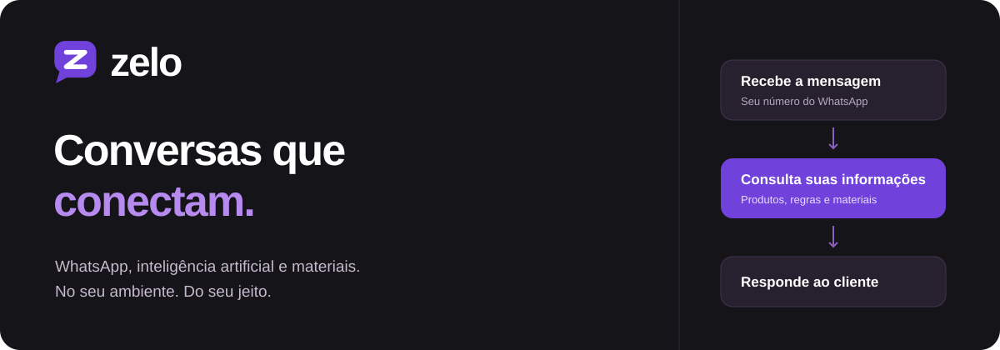
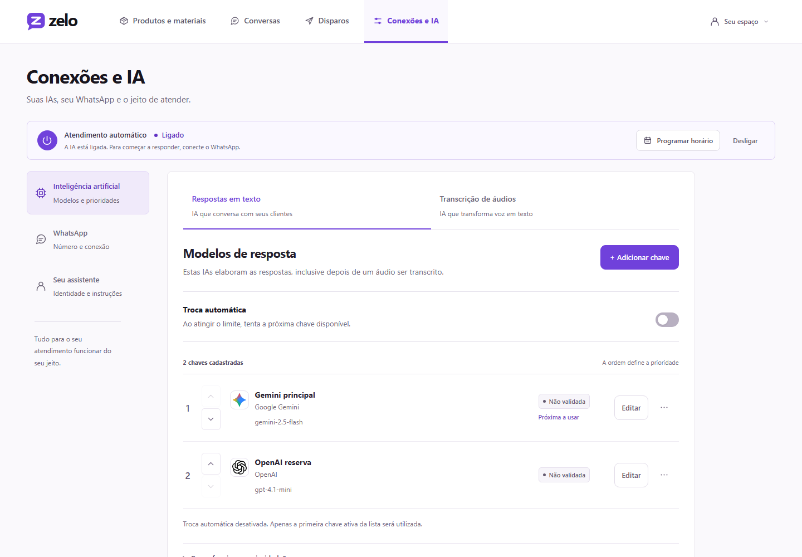
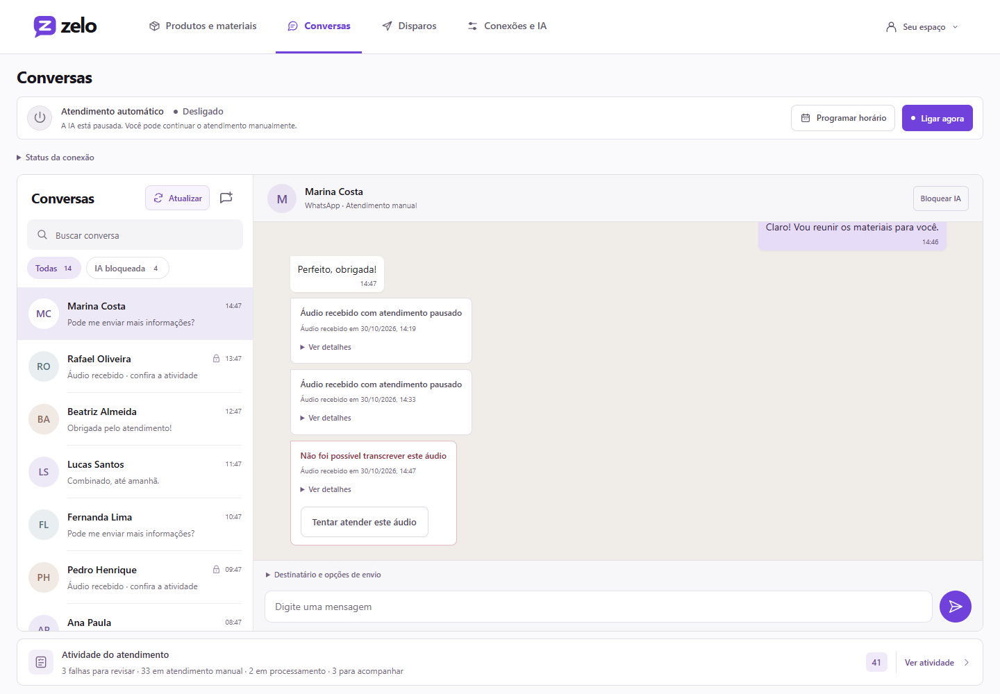
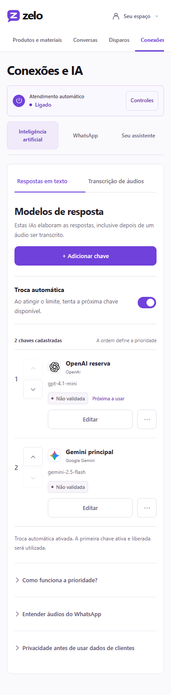
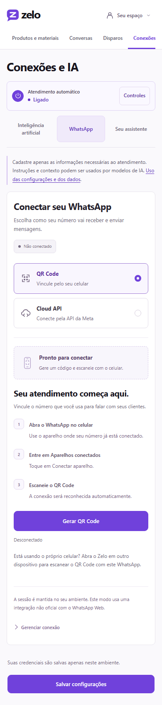
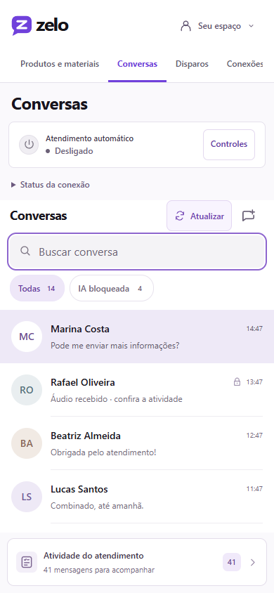
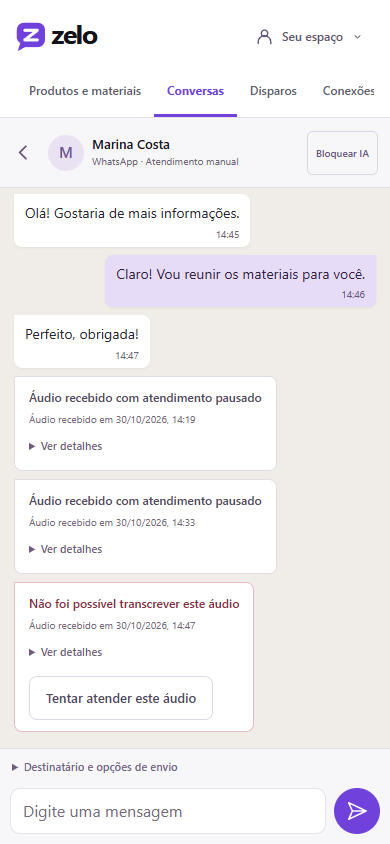
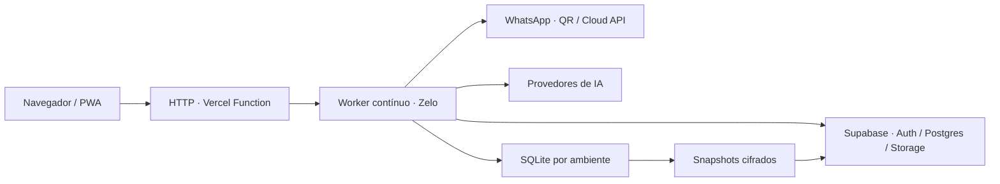

<div align="center">



# Zelo

### Seu WhatsApp. Suas IAs. Seu jeito de atender.

**Do primeiro contato ao acompanhamento de uma campanha, tudo no mesmo espaço.**

Organize produtos e materiais, conecte suas IAs, acompanhe conversas e prepare disparos com revisão antes do envio.

[**Abrir o Zelo ↗**](https://zelo-liard.vercel.app/) · [Começar agora](#começar-no-computador) · [Ver o painel](#o-zelo-por-dentro) · [Instalar o app](#zelo-como-app) · [Documentação](#documentação)


</div>

---

## Atendimento com contexto, operação com controle

O Zelo reúne o que o assistente precisa saber e o que você precisa acompanhar. Seus produtos dão contexto às respostas; suas regras definem a voz do atendimento; suas chaves determinam quais modelos entram em ação. Quando precisar assumir, a conversa e o envio manual estão no mesmo painel.

| Área | O que você faz |
| --- | --- |
| **Produtos e materiais** | Cadastre descrições, preços, imagens, PDFs e links. Mantenha as informações gerais do negócio em um só lugar. |
| **Conversas** | Busque contatos, acompanhe mensagens e áudios, responda manualmente e bloqueie a IA por pessoa. |
| **Conexões e IA** | Configure provedores, prioridades e listas independentes para respostas em texto e transcrição de áudios. |
| **Seu assistente** | Defina nome, tom de voz, regras e estrutura das respostas para todos os modelos. |
| **Disparos** | Importe contatos, personalize mensagens, vincule um produto e revise a campanha antes de confirmar. |
| **Histórico** | Acompanhe campanhas por empreendimento, filtre resultados e consulte entregas, leituras e falhas disponíveis. |
| **Atendimento automático** | Ligue, pause e programe horários, dias e períodos de funcionamento. |
| **Gestão de acessos** | No modo Supabase, controle convites e permissões, com dados e integrações separados por conta. |

## O que mudou por aqui

A revisão de **4 de novembro de 2026** reúne melhorias nas IAs, na operação e na experiência em telas menores:

- **IAs locais:** conexão com llama.cpp e Ollama, com modelos cadastrados e validados pelo painel.
- **Prioridade por arraste:** alças de seis pontos nas listas de texto e áudio, com salvamento automático e alternativa pelo teclado.
- **Estrutura das respostas:** orientações próprias para objetividade, parágrafos curtos e espaçamento, compartilhadas por todas as IAs de resposta.

- **PWA atualizado:** aviso de nova versão com **Atualizar Zelo**, recarga após escolha do usuário e recuperação quando a conexão falha.
- **Conexões no celular:** abas compactas, formulários com ações em largura total, controles de toque ampliados e QR Code com estado inicial mais enxuto.
- **Conversas mais claras:** contatos com avatares, busca, filtro de IA bloqueada, atividade expansível e área de envio ancorada abaixo do histórico.
- **Disparos com mais contexto:** produto visível na preparação, sugestão de mensagem com IA mediante confirmação de custo e personalização com os nomes disponíveis dos contatos.
- **Verificação no WhatsApp:** consulta de números pela conexão QR, sem enviar mensagens, com resultados separados entre encontrados, não encontrados e indisponíveis.
- **Histórico organizado:** grupos recolhíveis por empreendimento, busca e filtros, com exclusão confirmada de campanhas concluídas ou canceladas, preservando os registros operacionais.

Este README descreve o código do repositório. A disponibilidade dessas mudanças no site depende da implantação da versão correspondente.

## O Zelo por dentro

### Conexões que você controla

Modelos de texto e áudio têm suas próprias listas. Veja a prioridade, o estado de cada chave e qual está disponível para a próxima tentativa.



<details>
<summary><strong>Ver o painel de Conversas</strong></summary>

<br>


Busca, atendimento manual, bloqueio por contato e recuperação de falhas permanecem próximos da conversa. A atividade pode ser expandida quando você precisar conferir pendências e eventos.

</details>

<details>
<summary><strong>Ver Conexões no celular</strong></summary>

<br>
 

As abas se adaptam à largura da tela. Os formulários mantêm campos legíveis, menus acessíveis por toque e ações em largura total. Antes de gerar o QR Code, o estado ocupa menos espaço; quando disponível, o código conserva sua área de leitura.

</details>

<details>
<summary><strong>Ver Conversas no celular</strong></summary>

<br>
 

Lista e conversa aberta ocupam telas distintas. **Voltar** retorna à busca sem apagar o rascunho; a área de envio continua junto ao histórico.

</details>

*Capturas locais com contas, contatos e registros sintéticos. Os números exibidos são dados de demonstração, não métricas de uso. Origem das imagens em [docs/assets](docs/assets/README.md).*

## Do cadastro ao primeiro atendimento

1. **Entre na conta.** Em produção com Supabase, novas contas precisam de convite do administrador master.
2. **Monte sua base.** Em **Produtos e materiais**, cadastre o que o assistente deve conhecer.
3. **Escolha suas IAs.** Em **Conexões e IA → Inteligência artificial**, adicione as chaves, informe os IDs dos modelos e organize a prioridade. Configure textos e áudios em suas respectivas abas.
4. **Dê sua voz ao assistente.** Em **Seu assistente**, defina nome, instruções e regras de atendimento.
5. **Conecte o número.** Em **WhatsApp**, escolha QR Code ou Cloud API e conclua a configuração.
6. **Teste o atendimento.** Ajuste a programação e use outro número para conferir a conversa antes de atender clientes.

A validação de chaves, a transcrição e a geração de texto fazem chamadas reais e podem consumir cota ou créditos. O Zelo usa as credenciais que você cadastra; não inclui cotas de IA.

## Uma IA para responder. Outra, se você quiser, para ouvir.

**Respostas em texto:** Gemini, OpenAI, Anthropic, xAI, Groq, DeepSeek e OpenRouter, além de modelos locais pelo **llama.cpp** e **Ollama**.

**Transcrição de áudios:** lista própria com Gemini, Groq e OpenAI. O áudio recebido vira texto identificado no histórico; a IA da lista de textos prepara a resposta.

- **Organize a prioridade:** segure a alça de seis pontos e arraste o modelo. A ordem é salva ao soltar.
- Ative a troca automática quando quiser usar as reservas elegíveis.
- Edite, pause, valide ou remova cada cadastro pelo painel.
- Use **Observação** para registrar a finalidade de cada modelo.
- Mantenha instruções globais para dar continuidade ao atendimento mesmo quando o modelo mudar.

As listas de texto e áudio são independentes. A troca depende do tipo de falha e do provedor; erros de autenticação e configuração exigem correção. Chaves do mesmo projeto podem compartilhar a mesma cota.

<details>
<summary><strong>Conectar modelos locais com llama.cpp ou Ollama</strong></summary>

Mantenha o programa de IA aberto no mesmo computador do servidor Zelo. Não é necessária chave de API.

1. Abra **Conexões e IA → Inteligência artificial → Respostas em texto**.
2. Adicione um cadastro e selecione o programa que executa seu modelo.
3. Informe o nome exato do modelo, salve e use **Validar** no menu do cadastro.
4. Arraste a alça para posicioná-lo na prioridade desejada.

| Programa | Nome do modelo no cadastro |
| --- | --- |
| **llama.cpp** | Use o nome listado pelo aplicativo, por exemplo `Spark-X2.5-4B`. |
| **Ollama** | Use o nome exibido por `ollama list`, por exemplo `gemma4:e4b`. |

**Conexões locais usadas pelo Zelo:**

- llama.cpp: `http://127.0.0.1:9931/v1/chat/completions`.
- Ollama: `http://127.0.0.1:11434/api/chat`.

O primeiro carregamento pode demorar, e modelos maiores exigem mais memória. Esta integração local gera respostas em texto; a transcrição continua na lista de áudios.

> Em uma instalação hospedada, o endereço local aponta para o servidor da hospedagem. Para usar a IA do seu computador, execute o servidor Zelo nele.

</details>

<details>
<summary><strong>Organizar a prioridade pelo teclado</strong></summary>

Selecione a alça do modelo com **Tab** e use:

| Tecla | Ação |
| --- | --- |
| **Espaço** ou **Enter** | Iniciar a movimentação; pressionar novamente confirma e salva. |
| **↑** e **↓** | Mover o modelo na lista. |
| **Home** e **End** | Mover para o início ou fim da lista. |
| **Esc** | Cancelar e manter a prioridade anterior. |

</details>

<details>
<summary><strong>Usar modelos do OpenRouter</strong></summary>

Cadastre cada modelo separadamente, com seu ID completo. Você pode usar a mesma chave em cadastros distintos e organizar a prioridade pelo painel; isso não cria cotas independentes.

Cada requisição usa o modelo daquele cadastro. A chave é informada no campo protegido e não volta nas respostas da API. Modelos de embeddings não entram na lista de respostas. Se quiser testar apenas endpoints gratuitos, mantenha cadastros pagos pausados e confira as condições de cada modelo.

O endpoint gratuito do Nemotron sugerido pelo projeto deve ser usado somente com dados fictícios, conforme o aviso exibido na interface. Consulte os [limites do OpenRouter](https://openrouter.ai/docs/api_reference/limits) e as condições do endpoint antes de enviar dados reais.

</details>

Áudios de até **10 MB** são processados em memória, sem salvar o arquivo binário no catálogo. Falhas, pausas e transcrições ficam identificadas; o operador pode revisar e retomar o atendimento. Transcrições permanecem no histórico conforme a política de guarda do ambiente.

[Guia de áudio →](docs/audio.md) · [Bloqueio de IA por contato →](docs/bloqueio-de-contatos.md)

### A voz e a estrutura das respostas

Em **Conexões e IA → Seu assistente**, configure duas partes complementares:

| Área | O que definir |
| --- | --- |
| **Instruções globais** | Nome, tom de voz, regras do atendimento e informações que precisam de confirmação. |
| **Estrutura das respostas** | Objetividade, tamanho dos parágrafos, quebras de linha e espaçamento. |

As orientações de escrita já sugerem responder direto ao ponto, usar uma ou duas frases por parágrafo e separar os blocos com uma linha em branco. Edite como preferir e clique em **Salvar instruções do assistente**.

Essas orientações são salvas separadamente das instruções globais e acompanham todos os modelos de resposta, inclusive após uma troca automática.

## Disparos, da lista ao resultado

O fluxo segue **Contatos → Mensagem → Envio → Revisão**. Avançar valida a etapa; voltar preserva o rascunho. A campanha só entra na fila depois da confirmação final.

| Etapa | Recursos |
| --- | --- |
| **Contatos** | Cole números, selecione conversas ou importe CSV/XLSX de até **2 MB**. Até **500 contatos por campanha** e 32 colunas extras para personalização. |
| **Conferência** | Consulte números no WhatsApp pela conexão QR, sem enviar mensagens. Remova os não encontrados por decisão explícita. |
| **Mensagem** | Vincule um produto, insira informações do catálogo, use variáveis como `{nome}` e `{nome\|cliente}` ou gere uma sugestão com IA após confirmar o custo. |
| **Envio** | Escolha início, dias, horários, fuso, ritmo e limites. O servidor mantém a fila e a conexão original da campanha. |
| **Revisão** | Confira personalização, duplicados, inválidos, suprimidos e estimativa de duração. Declare o consentimento antes de **Confirmar e enviar**. |
| **Histórico** | Abra os grupos por empreendimento, busque, filtre, consulte destinatários e exporte resultados em CSV. |

O nome informado na importação tem prioridade. Quando faltar, o Zelo usa o nome disponível nos contatos da conta conectada; se não houver, respeita a alternativa da mensagem. A sugestão da IA só substitui seu texto quando você escolhe aplicá-la.

**Controle depois de confirmar:** pause, retome, cancele pendentes ou duplique para nova revisão. O reenvio em lote considera falhas; resultados incertos exigem conferência individual. Excluir do histórico é permitido para campanhas concluídas ou canceladas sem itens pendentes ou em envio e preserva os registros operacionais.

**Descadastro integrado:** palavras como **SAIR**, **PARAR**, **CANCELAR**, **STOP** e **NÃO QUERO RECEBER** registram a saída sem acionar a IA. A supressão é verificada na revisão e durante o envio. A confirmação de saída é configurável.

**Limites do recurso:** verificar um número não confirma entrega; aceite, entrega e leitura são estados diferentes. Os comprovantes dependem do transporte. Mídia em campanhas e filtros/listas/etiquetas avançados permanecem pendentes.

[Configuração, limites, ritmo e operação de Disparos →](docs/disparos.md)

## Zelo como app

Abra o [Zelo em HTTPS](https://zelo-liard.vercel.app/) no navegador do dispositivo:

| Dispositivo | Como instalar |
| --- | --- |
| **Android** | Toque em **Instalar Zelo**, quando disponível, ou use a opção de instalação do navegador. |
| **iPhone / iPad** | No Safari, use **Compartilhar → Adicionar à Tela de Início**. |
| **Computador** | Use o ícone de instalação ou o menu de aplicativos do navegador compatível. |

O PWA abre em janela própria e usa a mesma autenticação do site. A oferta de instalação depende do navegador.

**Atualizar no seu tempo.** Quando houver uma nova versão em espera, aparece **Atualizar Zelo**, com um aviso para salvar suas edições. O app não recarrega sozinho durante o uso; a janela que pediu a atualização recarrega após a ativação.

**Sem conexão, com recuperação.** O cache guarda apenas recursos públicos da tela de recuperação e da identidade do app. Conversas, produtos, anexos, APIs e páginas autenticadas ficam fora dele. Não há fila de mensagens offline no navegador.

> O PWA facilita o acesso. O atendimento automático continua dependendo do servidor ativo, do WhatsApp conectado e das APIs disponíveis.

[Instalação, atualizações e experiência móvel →](docs/pwa.md)

## Começar no computador

Requer **Node.js 22+** e npm.

```sh
git clone https://github.com/RafaelADSdev/Zelo.git
cd Zelo
npm ci --ignore-scripts
npm start
```

Com o Zelo em execução, use `node criar-admin.mjs` em outro terminal na pasta do projeto se ainda não houver administrador. Entre em **[127.0.0.1:4173](http://127.0.0.1:4173)** e configure as integrações pelo painel.

No Windows, use também **`INICIAR.cmd`** e **`PARAR.cmd`**. O modo local inicia um ambiente único e não exige Supabase para começar. Não reutilize nele a sessão de WhatsApp de uma produção ativa.

## Como o Zelo roda



**Interface:** HTML, CSS e JavaScript em módulos, sem etapa de compilação do frontend. **Servidor:** Node.js com filas persistentes, memória e conexões de longa duração. **Produção:** Supabase para autenticação, catálogo e materiais, com snapshots cifrados do atendimento.

A implantação separa uma Function HTTP e um Daemon. Uma Function isolada não substitui o processo contínuo necessário ao WhatsApp. Para configurar a produção, consulte [`.env.example`](.env.example), aplique as migrações e siga os guias de [Vercel](docs/vercel.md) e [ambientes privados](docs/workspaces.md).

Chaves secretas ficam no servidor. Mantenha `.env`, `.wappy`, materiais e backups fora do Git; preserve `SUPABASE_BACKUP_KEY` para recuperar os snapshots.

## Qualidade com evidência

```sh
npm test
```

Na verificação local de **04/11/2026**, **146 testes passaram**. A suíte cobre autenticação, isolamento, convites, chaves e prioridades de IA, áudio, persistência, filas, WhatsApp, uploads, programação, campanhas, histórico e política de cache do PWA. Os envios e chamadas de IA usam transportes controlados.

Conexões foi conferida no navegador em **320, 390, 768 e 1440 px**, incluindo formulários, rascunhos entre abas, menus, Cloud API e estados do QR Code. O PWA também teve a atualização por clique e a recuperação offline verificadas em tela de celular emulada. Isso não equivale a teste de instalação em aparelho físico.

Para consultar dependências, execute separadamente:

```sh
npm audit --omit=dev
```

O resultado da auditoria depende das dependências instaladas e da base consultada; não representa uma certificação de segurança do projeto.

## Limites da operação

- **WhatsApp por QR:** usa Baileys, uma integração não oficial com o WhatsApp Web. Mudanças, desconexões e bloqueios podem ocorrer; ritmo e jitter não eliminam esse risco.
- **Consentimento:** a declaração registrada no envio não comprova a origem da autorização dos contatos. Uma mensagem já entregue ao transporte antes do descadastro não pode ser desfeita.
- **Resultados incertos:** reenviar pode duplicar uma mensagem já recebida. O operador precisa conferir o contato antes de decidir.
- **Materiais:** imagens e PDFs ficam disponíveis como anexos; seu conteúdo não é extraído automaticamente para a base de conhecimento.
- **Provedores:** disponibilidade, cobrança, cotas e condições de uso dependem de cada serviço. Confira o tratamento de dados do plano antes de usar conversas reais.
- **Recuperação:** memória, filas e credenciais QR têm snapshots periódicos. Uma queda abrupta pode perder alterações posteriores ao último backup; catálogo e materiais remotos são persistidos diretamente no Supabase.

## Mapa do projeto

| Caminho | Responsabilidade |
| --- | --- |
| `public/` | Interface, estilos, módulos do navegador, identidade visual e PWA. |
| `lib/` | IA, áudio, autenticação, catálogo, atendimento, WhatsApp, HTTP e ambientes. |
| `server.mjs` | Entrada do servidor local. |
| `api/` e `deployment/` | Entradas e infraestrutura de hospedagem. |
| `supabase/` | Migrações e configuração de persistência remota. |
| `test/` | Suíte automatizada, executada com `npm test`. |
| `docs/` | Guias de produto, design, implantação e operação. |

Dados locais ficam em `.wappy/`, e materiais em `materiais/`; ambas as pastas são ignoradas pelo Git.

## Documentação

| Quero… | Abrir |
| --- | --- |
| Configurar o ambiente local | [Guia de operação](docs/guia-operacao.md) |
| Entender campanhas e seus limites | [Disparos](docs/disparos.md) |
| Configurar transcrição | [Áudios e listas de IA](docs/audio.md) |
| Assumir um contato manualmente | [Bloqueio de IA por contato](docs/bloqueio-de-contatos.md) |
| Instalar e atualizar o app | [PWA e mobile](docs/pwa.md) |
| Gerenciar contas e convites | [Ambientes privados](docs/workspaces.md) |
| Implantar em produção | [Vercel, Function e worker](docs/vercel.md) |
| Conhecer o produto | [Propósito e restrições](docs/product.md) |
| Consultar o visual do projeto | [Design geral](docs/design.md) · [Sistema visual](docs/settings/DESIGN.md) |
| Conferir a origem das capturas | [Imagens do README](docs/assets/README.md) |

## Créditos

Construído sobre [Wappy](https://github.com/csr1010/wappy-kit), [Baileys](https://github.com/WhiskeySockets/Baileys) e [Supabase](https://supabase.com/). Logos dos provedores por [Lobe Icons](https://github.com/lobehub/lobe-icons), com origem e licença em [`public/brand/providers`](public/brand/providers). Cada dependência e marca mantém seus respectivos termos.

---

<div align="center">

**Zelo · Conversas que conectam.**

Sua base. Sua voz. Seu atendimento.

[Voltar ao início ↑](#zelo)

</div>
