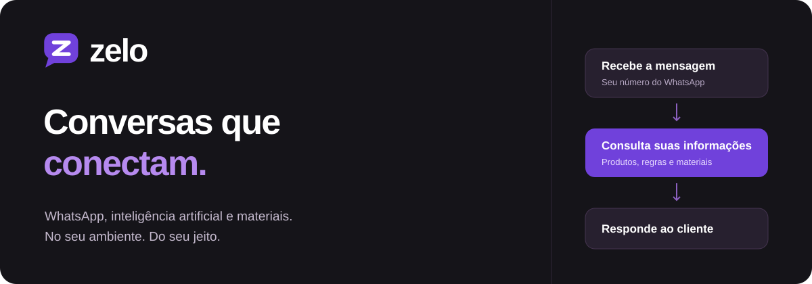
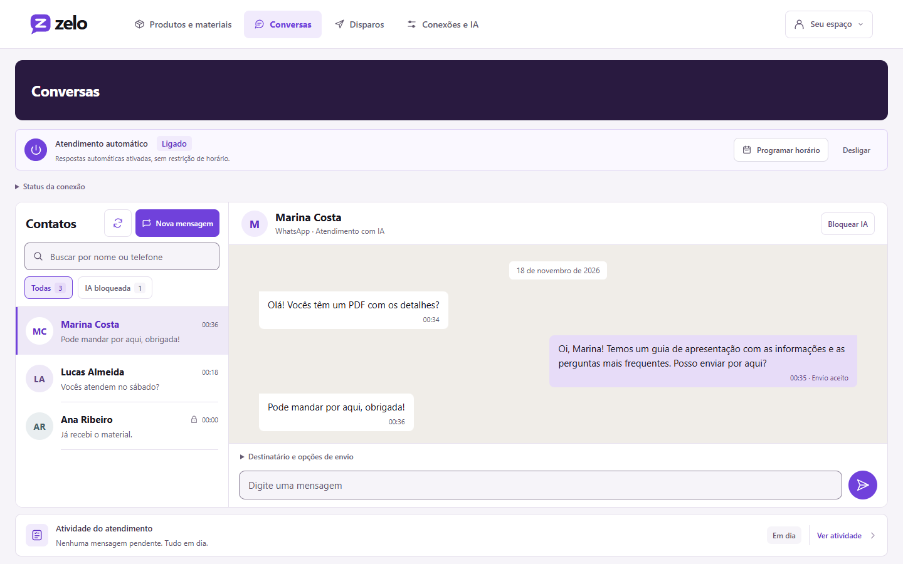
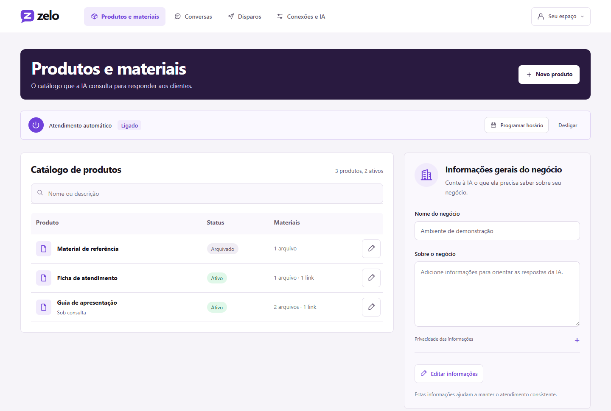
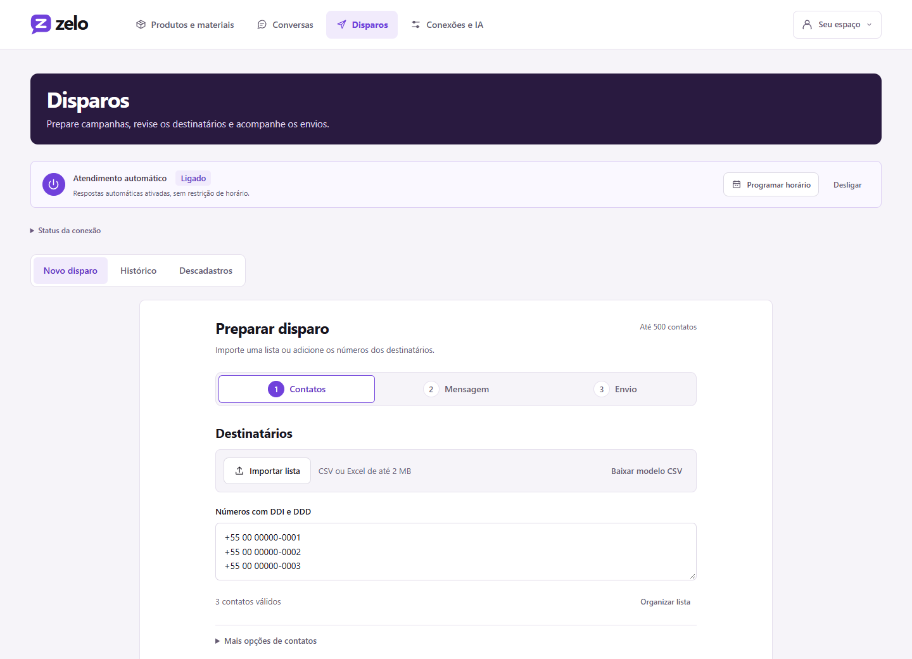
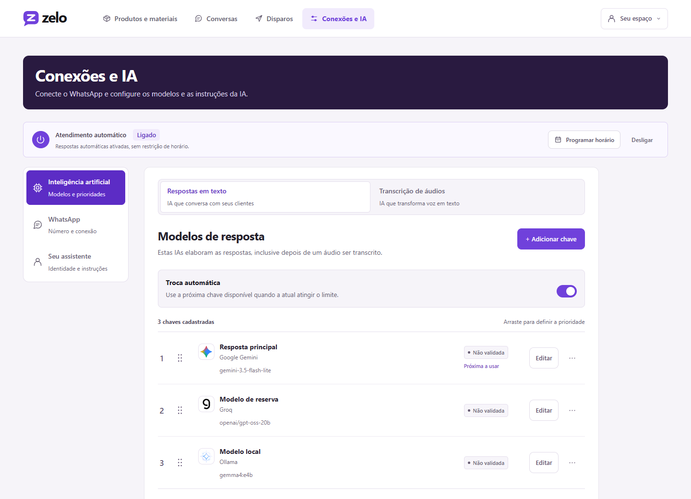
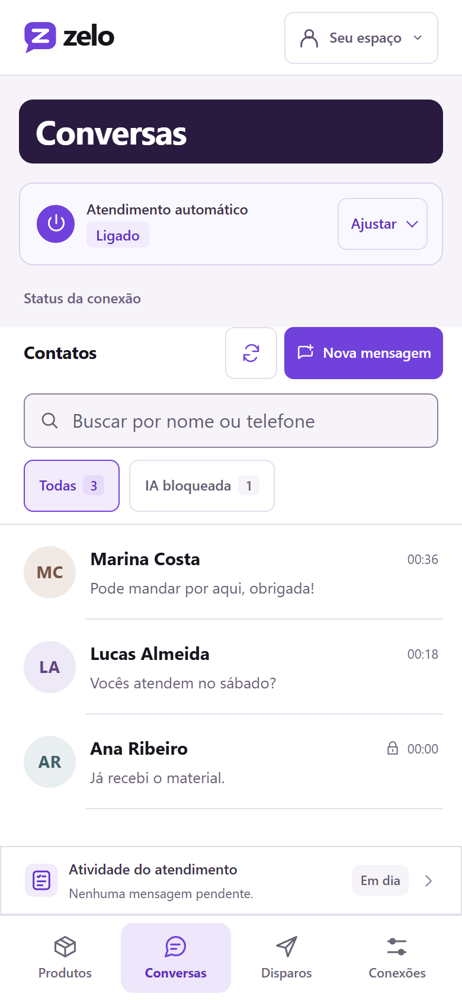
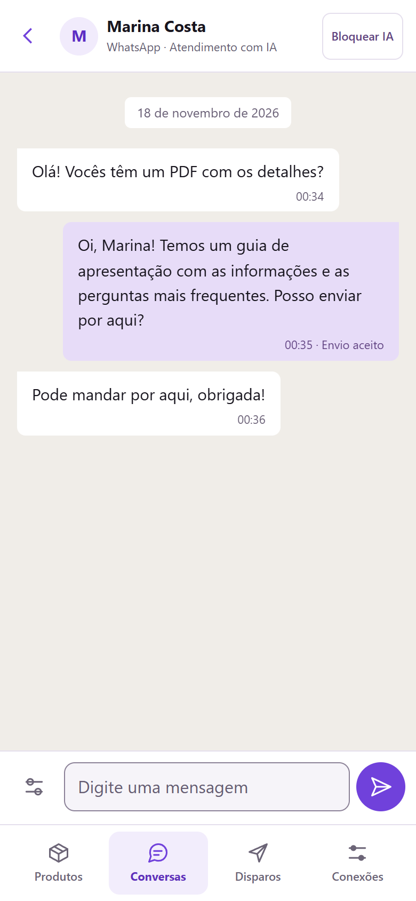
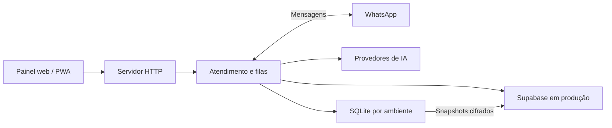

<div align="center">



# Zelo

**Atendimento no WhatsApp com a IA e o catálogo do seu negócio.**

[**Rodar localmente**](#rodar-localmente) · [Ver o painel](#por-dentro-do-zelo) · [Instalar como app](#instalar-como-app) · [Guias de configuração](#guias)


</div>

---

Cadastre descrições, preços, links e materiais. Quando chega uma pergunta no WhatsApp, o assistente consulta as fichas ativas, aplica as instruções do negócio e responde com o modelo configurado. No painel, você acompanha o histórico, assume o atendimento quando quiser e prepara campanhas com revisão antes do envio.

## Por dentro do Zelo



Em **Conversas**, abra o histórico, responda manualmente ou use **Bloquear IA** para assumir um contato. A atividade do atendimento reúne mensagens pendentes e falhas que precisam de revisão.

<details>
<summary><strong>Produtos e materiais</strong></summary>



Mantenha as informações gerais do negócio e as fichas de cada produto no mesmo lugar. O assistente consulta descrições e links e pode enviar anexos cadastrados quando o cliente pede material.

</details>

<details>
<summary><strong>Disparos</strong></summary>



Importe uma lista, personalize a mensagem e organize a janela de envio. A confirmação final mostra quais contatos podem entrar na fila.

</details>

<details>
<summary><strong>Conexões e IA</strong></summary>



Organize os modelos de texto e transcrição em listas independentes. Em **Seu assistente**, defina nome, tom de voz, regras e estrutura das respostas.

</details>

<details>
<summary><strong>No celular</strong></summary>

<p align="center">
  
  
</p>

A navegação inferior mantém Produtos, Conversas, Disparos e Conexões acessíveis. Em telas compactas, a conversa abre em tela própria e o botão **Voltar** preserva a busca e o rascunho.

</details>

*Capturas do painel atual com catálogo, contatos e mensagens de demonstração. [Origem das imagens](docs/assets/README.md).*

## O que mudou em novembro de 2026

- **Catálogo.** A lista mostra preço de referência, status e quantidade de materiais. A ficha aceita seleções sucessivas de anexos. Em uploads remotos, uma nova tentativa retoma do último trecho recebido.
- **Conversas e PWA.** A caixa de entrada ganhou um fluxo de **Nova mensagem**, proteção de rascunhos ao alternar entre contatos e navegação móvel com o compositor ajustado ao espaço disponível.
- **Disparos.** Campanhas prontas para enviar podem avançar enquanto outra aguarda seu horário ou limite. A prévia confere a janela do WhatsApp Cloud API na data do disparo agendado.
- **Contas e continuidade.** A VPS passou a aceitar logins independentes com convites válidos por 48 horas. Na Vercel, a migração `004` protege os snapshots quando muda o worker responsável.
- **Mais opções de IA.** O painel passou a oferecer Experiential Labs na lista de provedores de texto.

## Rodar localmente

Requer **Node.js 22 ou superior**, npm e Git.

**1. Baixe o projeto e inicie o servidor.**

```sh
git clone https://github.com/RafaelADSdev/Zelo.git
cd Zelo
npm ci --ignore-scripts
npm start
```

**2. Crie o primeiro administrador.** Com o servidor em execução, abra outro terminal na pasta do projeto. O comando pede um usuário e uma senha de pelo menos 12 caracteres.

```sh
node criar-admin.mjs
```

**3. Abra o painel.** Entre em [http://127.0.0.1:4173](http://127.0.0.1:4173) e configure suas integrações em **Conexões e IA**.

> **Windows.** Com o projeto baixado, `INICIAR.cmd` instala as dependências na primeira execução e abre o servidor. Use `PARAR.cmd` ou **Ctrl+C** no terminal do servidor para encerrar.

A configuração padrão usa SQLite e deixa o painel acessível neste computador. Mantenha o servidor em execução e o WhatsApp conectado para receber e responder mensagens.

## Configurar o primeiro atendimento

1. **Preencha a base.** Em **Produtos e materiais**, cadastre o que o assistente deve consultar. O catálogo aceita imagens de até **10 MB** e PDFs de até **50 MB**. Escreva na descrição as informações que a IA precisa conhecer, pois a consulta usa o conteúdo das fichas. O envio de anexos segue os limites do canal.
2. **Escolha as IAs.** Em **Conexões e IA → Inteligência artificial**, cadastre os modelos e organize a prioridade. Salve as regras e o estilo de escrita em **Seu assistente**.
3. **Conecte o WhatsApp.** Escolha um dos canais abaixo na aba **WhatsApp**.
4. **Ligue ou programe o atendimento.** Escolha dias, horários e, se necessário, um período. Use outro número para testar uma pergunta sobre um produto antes de atender clientes.

### Conectar o WhatsApp

| Canal | Como funciona |
| --- | --- |
| **QR Code** | Vincule o número por **Aparelhos conectados** no celular. A conexão usa Baileys, uma integração não oficial com o WhatsApp Web sujeita a desconexões e restrições do WhatsApp. |
| **Cloud API** | Configure a conta da Meta e um webhook público HTTPS. Use texto livre na janela de atendimento de 24 horas e templates aprovados para iniciar ou retomar conversas fora da janela. |

[Guia de operação e configuração da Cloud API](docs/guia-operacao.md)

### Escolher os modelos

| Uso | Provedores disponíveis no código |
| --- | --- |
| **Respostas em texto** | Google Gemini, OpenAI, Anthropic, Experiential Labs, xAI, Groq, DeepSeek, OpenRouter, llama.cpp e Ollama. |
| **Transcrição de áudios** | Google Gemini, Groq e OpenAI. O áudio de até **10 MB** vira texto no histórico, e um modelo da lista de respostas prepara o retorno. |

Cada cadastro usa o ID completo do modelo. Arraste a alça para mudar a prioridade ou use **Tab** para selecionar a alça, **Espaço** para começar e confirmar e **↑/↓** para mover. A troca automática usa o próximo modelo elegível quando o atual atinge um limite de uso.

Para usar **llama.cpp** ou **Ollama**, execute o modelo na máquina que hospeda o Zelo e informe seu nome no painel. Os endpoints esperados são `http://127.0.0.1:9931/v1/chat/completions` para llama.cpp e `http://127.0.0.1:11434/api/chat` para Ollama. As integrações em nuvem usam as chaves cadastradas. Validar um modelo ou gerar uma resposta pode consumir a cota do provedor. [Guia de áudios](docs/audio.md)

## Disparos com revisão

1. **Contatos.** Cole números, selecione conversas ou importe CSV/XLSX de até **2 MB**, com até **500 contatos por campanha**. Pela conexão QR, você pode consultar se os números estão no WhatsApp antes de enviar.
2. **Mensagem.** Vincule um produto, insira dados do catálogo e personalize com variáveis como `{nome}` ou `{nome|cliente}`. A sugestão da IA é aplicada quando você escolhe usá-la.
3. **Envio.** Defina início, dias, horários, fuso, ritmo e limites. A fila mantém a conexão usada na confirmação.
4. **Revisão.** Confira a prévia, duplicados, inválidos e descadastros. Confirme o consentimento dos destinatários antes de enfileirar.

O **Histórico** permite buscar campanhas por empreendimento, consultar o resultado por destinatário, exportar CSV e pausar ou retomar envios. Palavras como **SAIR** e **PARAR** registram o descadastro, que é verificado na revisão e durante o envio. Aceite, entrega e leitura são estados distintos e dependem dos comprovantes do canal. Confira resultados incertos no WhatsApp antes de reenviar. [Guia de Disparos](docs/disparos.md)

## Instalar como app

Abra o endereço HTTPS da sua instalação do Zelo em um navegador compatível.

| Dispositivo | Instalação |
| --- | --- |
| **Android** | Toque em **Instalar Zelo** ou use a opção de instalação do navegador. |
| **iPhone e iPad** | No Safari, vá a **Compartilhar → Adicionar à Tela de Início**. |
| **Computador** | Use o ícone ou a opção de instalação do navegador. |

Quando uma versão nova estiver pronta, use **Atualizar Zelo** depois de salvar suas edições. O cache offline guarda os recursos públicos da tela de recuperação. [Guia do PWA](docs/pwa.md)

## Arquitetura e implantação

O painel usa HTML, CSS e JavaScript nativos. O servidor Node.js mantém as filas e a conexão com o WhatsApp. Em produção com Supabase, cada login autorizado tem seu próprio catálogo, conversas, integrações e instruções. O administrador master gerencia convites e suspensões.



| Onde roda | Processo |
| --- | --- |
| **Computador** | [`server.mjs`](server.mjs) com um ambiente local. |
| **VPS** | [`deployment/vps.mjs`](deployment/vps.mjs) com múltiplas contas, Supabase e proxy HTTPS. |
| **Vercel** | [`api/index.mjs`](api/index.mjs) atende HTTP, e [`deployment/worker.mjs`](deployment/worker.mjs) mantém o atendimento ativo em um Daemon. |

Em produção, o catálogo e os anexos ficam no Postgres e no Storage privado. O estado do atendimento usa SQLite, com snapshots cifrados no Supabase. Preserve a chave `SUPABASE_BACKUP_KEY` para restaurá-los. Na Vercel, aplique as migrações `001` a `004` antes de iniciar o worker. [Variáveis de ambiente](.env.example) · [Ambientes privados](docs/workspaces.md) · [Guia da Vercel](docs/vercel.md)

## Desenvolvimento

| Comando | O que faz |
| --- | --- |
| `npm start` | Inicia o servidor de desenvolvimento. |
| `npm test` | Executa a suíte automatizada. |
| `npm audit --omit=dev` | Consulta alertas das dependências de produção. |

Em **18 de novembro de 2026**, os **171 testes** da suíte passaram. Ela cobre autenticação, isolamento de contas, catálogo e uploads, transcrição, prioridades de IA, filas, WhatsApp, campanhas e cache do PWA. Os testes usam transportes controlados.

- [`public/`](public/) guarda o painel, os estilos e o PWA.
- [`lib/`](lib/) concentra catálogo, autenticação, IA, áudio e WhatsApp.
- [`deployment/`](deployment/) e [`supabase/`](supabase/) reúnem as entradas de produção e migrações.
- [`test/`](test/) contém a suíte.

O Git ignora `.wappy/` e `.env`, onde ficam dados locais, sessões e credenciais.

## Guias

| Quero | Onde consultar |
| --- | --- |
| Configurar o servidor e o WhatsApp | [Guia de operação](docs/guia-operacao.md) |
| Preparar e acompanhar campanhas | [Disparos](docs/disparos.md) |
| Transcrever áudios e revisar falhas | [Áudio](docs/audio.md) |
| Assumir um atendimento manualmente | [Bloqueio de IA por contato](docs/bloqueio-de-contatos.md) |
| Instalar e atualizar o app | [PWA e experiência móvel](docs/pwa.md) |
| Convidar usuários e administrar ambientes | [Ambientes privados](docs/workspaces.md) |
| Publicar a Function e o Daemon | [Implantação na Vercel](docs/vercel.md) |
| Consultar a identidade visual e os componentes | [Design do Zelo](docs/design.md) · [Conexões e IA](docs/settings/DESIGN.md) |

## Créditos

O Zelo usa [SDK da Wappy](https://github.com/csr1010/whatsapp-ai-agent-sdk), [Baileys](https://github.com/WhiskeySockets/Baileys) e [Supabase](https://supabase.com/). Os ícones dos provedores vêm de [Lobe Icons](https://github.com/lobehub/lobe-icons). [Origem e licença dos ícones](public/brand/providers/README.md)

---

<div align="center">

[Voltar ao início ↑](#zelo)

</div>
