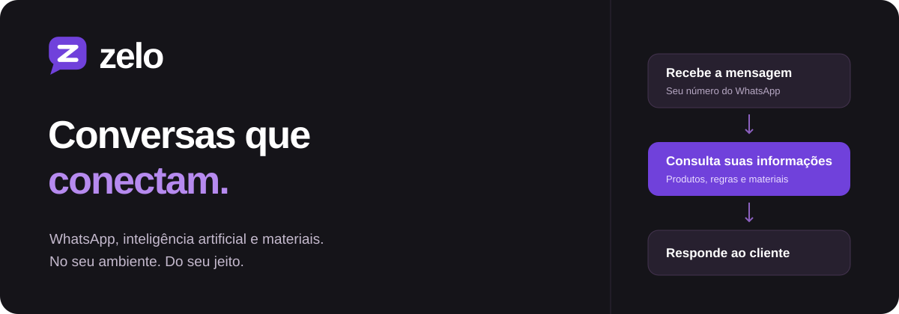
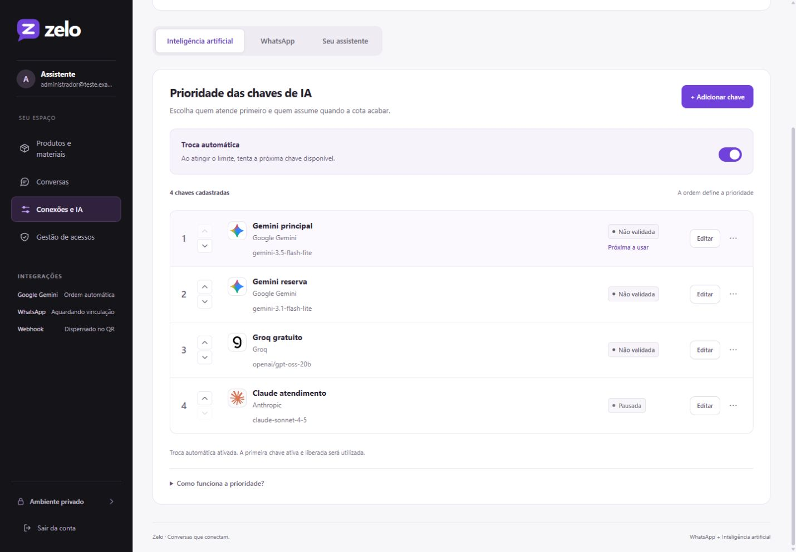
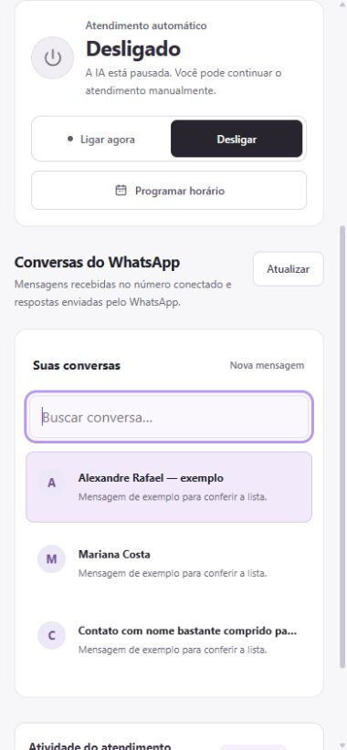
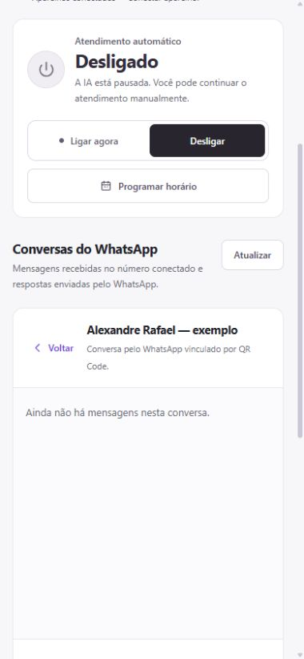
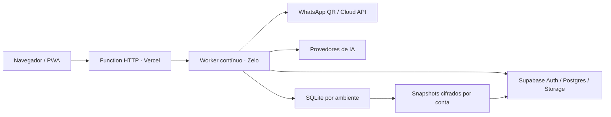

<div align="center">



# Zelo

**Um espaço para cuidar do seu atendimento no WhatsApp.**

Produtos, materiais, inteligência artificial e controle de acesso — com a sua configuração, no seu ambiente.

[**Abrir o Zelo**](https://zelo-liard.vercel.app/) · [Começar](#começar-no-computador) · [Instalar no celular](#na-tela-inicial-do-seu-celular) · [Documentação](#documentação)


</div>

## O atendimento, organizado

O Zelo conecta seu WhatsApp a uma base de informações que você controla. Cadastre produtos, reúna imagens, PDFs e links, defina as instruções do assistente e escolha quais modelos de IA podem responder.

Na implantação com Supabase, cada conta autorizada tem seu próprio WhatsApp, suas próprias APIs e seus próprios dados. O administrador master controla os convites e os acessos.

| Você precisa de… | O Zelo oferece |
| --- | --- |
| Um número conectado | Vinculação por QR Code ou WhatsApp Cloud API. |
| Liberdade para escolher a IA | Gemini, GPT/OpenAI, Claude/Anthropic, Grok/xAI, Groq, DeepSeek e OpenRouter. |
| Continuidade quando acaba a cota | Chaves em ordem de prioridade, troca automática por limite/créditos e pausa individual. |
| Uma base útil para responder | Produtos com descrição, imagens, PDFs, links e informações gerais do negócio. |
| Controle do atendimento | Ligar, desligar e programar horários, dias e períodos. |
| Acompanhar as conversas | Histórico, busca, envio manual, pendências e eventos. |
| Ambientes separados | Login, convites e isolamento por conta no modo de produção com Supabase. |
| Acesso no celular | Interface adaptada para toque e instalação como PWA. |

## Por dentro do painel



*Capturas do aplicativo real em um ambiente de teste, com conta e registros sintéticos. Nenhuma credencial ou conversa de cliente é exibida.*

<details>
<summary><strong>Ver a experiência no celular</strong></summary>
<br>
 

No celular, a lista e a conversa aberta ocupam telas distintas. Use **Voltar** para escolher outro contato ou **Nova mensagem** para iniciar um envio manual. Campos maiores, controles de toque e margens para a área segura ajudam no uso diário.
</details>

## Seu primeiro atendimento

1. Entre na conta. Novas contas de produção precisam de convite do administrador master.
2. Em **Produtos e materiais**, cadastre o que o assistente deve conhecer.
3. Em **Conexões e IA → Inteligência artificial**, adicione uma chave e o ID completo do modelo, organize a prioridade e valide.
4. Em **Seu assistente**, defina o nome e as instruções globais.
5. Em **WhatsApp**, escolha QR Code ou Cloud API e conclua a conexão.
6. Configure **Atendimento automático** e teste usando outro número do WhatsApp.

A validação de uma chave faz uma chamada real ao provedor e pode consumir cota ou créditos. O Zelo não fornece chaves nem cotas de IA.

### OpenRouter gratuito para testes

Em **Conexões e IA → Adicionar chave**, selecione **OpenRouter** e cadastre cada modelo separadamente. O modelo sugerido é `nvidia/nemotron-3-ultra-550b-a55b:free`. Ultra, Nemotron 3.5 Super VL e as versões Gemma 4 31B e 26B A4B aceitam a mesma chave em cadastros distintos. Use **Observação** para registrar porte, contexto e se o endpoint é gratuito ou pago; use as setas para definir a prioridade. Os cadastros da mesma conta compartilham a cota do OpenRouter.

Cada requisição especifica somente o modelo daquele cadastro, sem reserva oculta no OpenRouter. Com a troca automática ligada, o Zelo tenta o próximo cadastro ativo em caso de limite, modelo indisponível, falha transitória ou resposta inválida do OpenRouter; erros de autenticação e configuração precisam ser corrigidos. A função `responder` produz a resposta do atendimento e seu conteúdo é validado no servidor, sem executar ferramentas externas. A chave é cadastrada pelo campo protegido do painel e não volta nas respostas da API. Não a cole em chats, código do navegador ou arquivos versionados. Os modelos Embed são de busca semântica e não devem entrar na lista de respostas. Versões pagas devem permanecer pausadas se a intenção é usar somente modelos gratuitos.

Use essa sugestão apenas com dados fictícios: o endpoint gratuito do Nemotron registra conteúdo e pede que não sejam enviados dados pessoais ou confidenciais. A integração não ativa nem altera chaves já cadastradas. O OpenRouter publica cotas gerais de 50 requisições/dia e 20/minuto sem compra de créditos, ou 1.000/dia após US$ 10 de compras acumuladas; disponibilidade e regras podem mudar. Confira as [condições do modelo](https://openrouter.ai/nvidia/nemotron-3-ultra-550b-a55b:free), os [limites](https://openrouter.ai/docs/api_reference/limits) e o [funcionamento da reserva](https://openrouter.ai/docs/guides/routing/model-fallbacks).

## Controle por contato

Em **Conversas**, use **Bloquear IA** para impedir respostas e transcrições para uma pessoa, mantendo o atendimento manual. O filtro de contatos bloqueados e o botão **Desbloquear IA** ajudam a gerenciar a lista. O bloqueio fica salvo por ambiente e WhatsApp conectado; desbloquear libera novas mensagens, sem responder às antigas em lote.

[Detalhes do bloqueio de contatos →](docs/bloqueio-de-contatos.md)

## Mensagens de voz

O assistente entende áudios recebidos no WhatsApp, por QR Code e Cloud API, e responde em texto. A transcrição aparece no histórico com a identificação **Áudio transcrito**. Use uma chave ativa de Gemini, Groq ou OpenAI; o Zelo respeita a ordem entre as chaves compatíveis e tenta uma reserva por limite quando a troca automática está ligada. Transcrever também consome cota ou créditos.

Arquivos de até **10 MB**; áudios vazios, inacessíveis, incompreensíveis ou recusados pelo provedor ficam com erro na fila para revisão. O atendimento pausado ou fora do horário não baixa nem transcreve automaticamente. O operador pode retomar pela fila. O arquivo é processado em memória; o texto reconhecido permanece no histórico. Confira as condições de privacidade do provedor antes de usar dados reais.

[Funcionamento, limites e testes de áudio →](docs/audio.md)

## Na tela inicial do seu celular

Abra o [site em HTTPS](https://zelo-liard.vercel.app/) no navegador do dispositivo:

- **Android:** use **Instalar Zelo**, quando disponível, ou a opção de instalar no menu do navegador compatível.
- **iPhone / iPad:** no Safari, use **Compartilhar → Adicionar à Tela de Início**.
- **Computador:** use o ícone de instalação ou o menu de aplicativos do navegador compatível.

O app abre em janela própria e usa a mesma autenticação do site. A promoção e a disponibilidade da instalação dependem do navegador.

**Offline com privacidade:** o service worker guarda apenas recursos públicos da tela de recuperação e da identidade do aplicativo. Conversas, produtos, arquivos, APIs e páginas autenticadas não entram no cache offline. Sem conexão, aparece uma tela para tentar novamente; mensagens não são enfileiradas no navegador.

> Instalar o PWA não mantém o WhatsApp funcionando no celular por conta própria. O atendimento depende do servidor, do WhatsApp conectado e das APIs disponíveis.

[Detalhes de instalação, cache e atualização →](docs/pwa.md)

## Começar no computador

Requer **Node.js 22+** e npm.

```sh
git clone https://github.com/RafaelADSdev/Zelo.git
cd Zelo
npm ci --ignore-scripts
npm start
```

Acesse [127.0.0.1:4173](http://127.0.0.1:4173). O servidor local inicia um ambiente único. Crie o administrador com o código gerado em `.wappy/primeiro-acesso.txt` e configure suas integrações pelo painel. No Windows, também há `INICIAR.cmd` e `PARAR.cmd`.

O modo local não exige Supabase para começar. Não reutilize a mesma sessão do WhatsApp de uma implantação de produção ativa.

## Produção e arquitetura



A interface usa HTML, CSS e JavaScript em módulos, sem compilação do frontend. O worker mantém filas, memória e conexões de longa duração. Produtos e anexos usam o Supabase; snapshots cifrados permitem restaurar o atendimento.

A implantação atual separa uma Function HTTP e um Daemon. Uma Function isolada não substitui o processo contínuo necessário ao WhatsApp. Configure as variáveis de servidor em [`.env.example`](.env.example), aplique as migrações e siga os guias de [implantação](docs/vercel.md) e [ambientes privados](docs/workspaces.md).

**As chaves secretas ficam no servidor.** Não use prefixos públicos nas variáveis, não publique `.env`, `.wappy` ou backups e preserve `SUPABASE_BACKUP_KEY` para recuperar os snapshots.

## Qualidade e validação

```sh
npm test
npm audit --omit=dev
```

Os testes cobrem autenticação, isolamento, convites, prioridade de IA, persistência, filas, WhatsApp, uploads, programação, movimento acessível e a política de cache do PWA. Transportes controlados evitam enviar mensagens reais durante a suíte.

## Limites que importam

- O QR usa **Baileys**, integração não oficial com o WhatsApp Web, sujeita a mudanças e desconexões.
- Imagens e PDFs são anexos disponíveis para envio; seu conteúdo não é extraído automaticamente para a base de conhecimento.
- A troca de IA trata limites/créditos elegíveis. Chaves inválidas e modelos incorretos precisam ser corrigidos.
- Memória, filas e credenciais QR têm snapshots periódicos. Uma queda abrupta pode perder alterações posteriores ao último backup; catálogo e materiais remotos são persistidos diretamente no Supabase.
- A disponibilidade depende do servidor, da hospedagem, do WhatsApp e das cotas dos provedores.

## Organização do projeto

- `server.mjs`: entrada do servidor local; `INICIAR.cmd` e `PARAR.cmd` continuam na raiz.
- `lib/`: módulos agrupados por responsabilidade em `ai/`, `audio/`, `auth/`, `catalog/`, `atendimento/`, `core/`, `supabase/`, `whatsapp/`, `http/`, `tunnel/` e `workspaces/`.
- `public/`: interface e arquivos públicos; identidade visual em `public/brand/`.
- `api/` e `deployment/`: entradas e infraestrutura de hospedagem.
- `supabase/`: migração e histórico de migrations.
- `test/`: testes automatizados; execute com `npm test`.
- `docs/`: documentação de produto, design e operação.

Os dados locais continuam em `.wappy/`, e os materiais em `materiais/`; ambas as pastas são ignoradas pelo Git.

## Documentação

| Guia | Conteúdo |
| --- | --- |
| [Produto](docs/product.md) | Público, propósito e restrições do produto. |
| [Design geral](docs/design.md) | Registro visual geral do projeto. |
| [PWA e mobile](docs/pwa.md) | Instalação, funcionamento offline, atualização e navegação móvel. |
| [Ambientes privados](docs/workspaces.md) | Convites, administrador master, isolamento e recuperação. |
| [Vercel](docs/vercel.md) | Function, worker, variáveis e limites da implantação. |
| [Operação detalhada](docs/guia-operacao.md) | Configuração local e detalhes da instalação original. |
| [Sistema visual](docs/settings/DESIGN.md) | Componentes, estados, responsividade e movimento. |

## Créditos

Construído sobre [Wappy](https://github.com/csr1010/wappy-kit), [Baileys](https://github.com/WhiskeySockets/Baileys) e [Supabase](https://supabase.com/). Logos dos provedores por [Lobe Icons](https://github.com/lobehub/lobe-icons), com licença e origem em [`public/brand/providers`](public/brand/providers). Cada dependência e marca mantém seus respectivos termos.

---

<div align="center"><strong>Zelo · Conversas que conectam.</strong></div>
